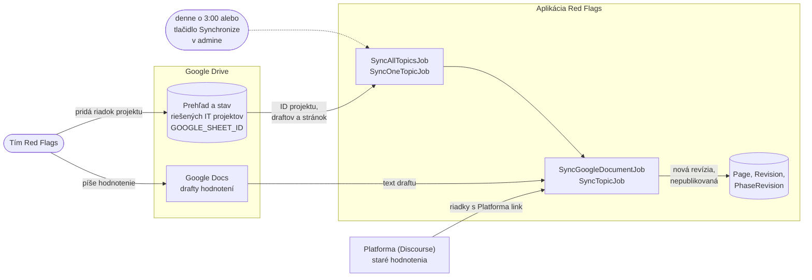
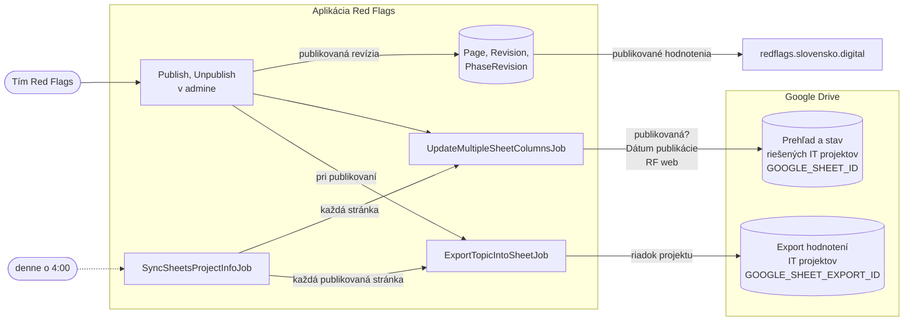

# Red Flags Public Facing Website

## Hodnotenia v Google Drive

Tím píše hodnotenia v Google Docs a zoznam projektov vedie v tabuľke *Prehľad a stav riešených IT projektov*. Aplikácia z draftov vytvára nové revízie, tím ich publikuje v admine a aplikácia zapisuje späť do tabuliek, čo je publikované.

### Import hodnotení

- Hlavička tabuľky je v 3. riadku, projekty začínajú vo 4. riadku. Aplikácia do tabuľky riadky nepridáva. Nový projekt potrebuje riadok od tímu s `Projekt ID`, ID draftov (`ID draft prípravy`, `ID draft produktu`) a ID stránok v aplikácii (`ID prípravy`, `ID produktu`).
- Import o 3:00 a *Synchronize Google* prejdú riadky s ID draftu. Preskočia drafty, ktoré sa stále volajú `Kópia dokumentu RF-priprava-template` alebo `Kópia dokumentu RF-produkt-template`. *Synchronize All* navyše stiahne staré hodnotenia z Platformy pre riadky s `Platforma link`. *Synchronize this* stiahne riadok jednej stránky.
- `Projekt ID` sa použije, len keď stránka v aplikácii ešte neexistuje. Neskoršia zmena stránku do iného projektu nepresunie.
- Každý projekt má mať jeden riadok. *Synchronize this* aj zápis stavu publikácie použijú prvý riadok s ID stránky, import o 3:00 prejde všetky riadky.

### Publikovanie

- Publish a Unpublish zapíšu do riadka stránky v *Prehľade* stĺpce `Príprava publikovaná?` alebo `Produkt publikovaný?`, `Dátum publikácie …` a `RF web …`. Job o 4:00 ich zapíše znova pre každú stránku.
- *Export hodnotení IT projektov* (hárok `Hárok1`) má jeden riadok na projekt, ktorý hľadá podľa `Projekt ID`. Nový projekt pridá pod posledný riadok. Zrušenie publikovania riadok neodstráni. Ak treba tabuľku naplniť nanovo, vymaž hodnoty pod hlavičkou (od 4. riadka) a spusti `bin/rails redflags:sync_sheets`.

## Úlohy na pozadí

Úlohy (ActiveJob) spúšťa [GoodJob](https://github.com/bensheldon/good_job) vo vlákne webového servera, samostatný worker ani clock netreba. Beží vždy len jedna úloha naraz. Denný import o 3:00, zápis do tabuliek o 4:00 a synchronizáciu s MetaIS o 5:00 a 6:00 plánuje GoodJob v `config/initializers/good_job.rb` podľa systémového času kontajnera. Ručne sa dajú spustiť rake úlohami z `lib/tasks`, napríklad `bin/rails redflags:sync_sheets`. Fronta, padnuté úlohy a plán sú v admine na `/admin/jobs`.

Úlohy, ktoré padnú na dočasnej chybe Google API (limit požiadaviek, chyba servera, timeout), sa zopakujú až päťkrát v priebehu niekoľkých minút. Ostatné chyby sa neopakujú, úloha ostane v `/admin/jobs` medzi padnutými.
